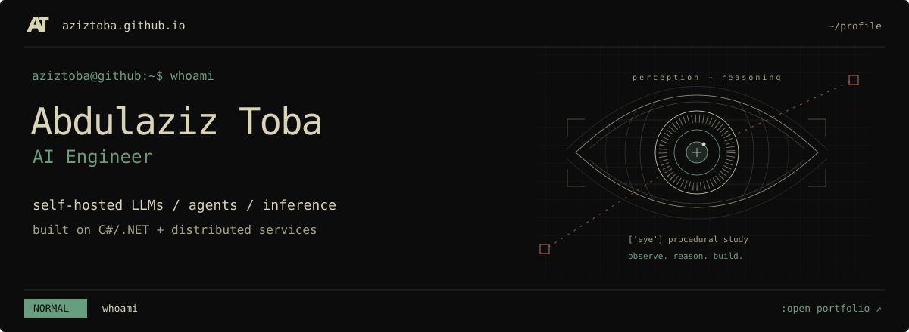

<a href="https://aziztoba.github.io" title="Enter the interactive portfolio">
  <picture>
    <source media="(max-width: 600px)" srcset="./assets/terminal-mobile.svg" />
    
  </picture>
</a>

<p align="center">
  <a href="https://aziztoba.github.io"><strong>enter portfolio ↗</strong></a> &nbsp; / &nbsp;
  <a href="https://aziztoba.github.io/Abdulaziz_Toba_AI_Engineer_CV.pdf">résumé.pdf</a> &nbsp; / &nbsp;
  <a href="https://www.linkedin.com/in/aziztoba">linkedin</a> &nbsp; / &nbsp;
  <a href="mailto:abdulaziztoba@outlook.com">email</a>
</p>

### `:whoami`

AI engineer building **self-hosted LLM systems, agent workflows, and inference infrastructure**, backed by production experience in C#/.NET and distributed services.

```text
aziztoba@github:~$ cat focus.conf

[agents]
LangChain · LangGraph
Self-hosted LLMs

[inference]
Model serving · quantization
Continuous batching

[backend]
C# / .NET · SQL Server · Redis
Distributed services
```

### `:open work/`

Selected professional work. Follow each link for its public overview.

| Project | Engineering focus |
| :--- | :--- |
| [Voice Agent ↗](https://aziztoba.github.io/site/#voice-agent) | Local-model conversation workflows and agent orchestration connected to backend services. |
| [AI Code Review ↗](https://aziztoba.github.io/site/#ai-code-review) | Asynchronous .NET review jobs with structured LLM findings and severity-based outcomes. |
| [Local LLM Inference ↗](https://aziztoba.github.io/site/#local-inference) | Model serving, quantization, batching, and latency / throughput / memory tradeoffs. |
| [MEC e-Services ↗](https://aziztoba.github.io/site/#mec-services) | Government service workflows, permit validation, and integration work at MANNAI / Qatar MEC. |

### `:ls public/`

- **[aziztoba.github.io](https://github.com/aziztoba/aziztoba.github.io)** — The interactive portfolio: a Vim-style terminal, procedural graphics, a rotating project wheel, and 28 themes. Next.js / React / TypeScript.
- **[drip-scheduler](https://github.com/aziztoba/drip-scheduler)** — Scheduled course delivery, creator tools, and member progress. TypeScript / Next.js / React.
- **[MediatorFromScratch](https://github.com/aziztoba/MediatorFromScratch)** — A C# engineering example exploring request dispatch, handlers, and dependency injection.

<p align="right"><a href="https://github.com/aziztoba?tab=repositories">:browse repositories ↗</a></p>

---

<p align="center"><code>:q github</code> &nbsp; → &nbsp; <a href="https://aziztoba.github.io"><code>:open aziztoba.github.io</code></a></p>
